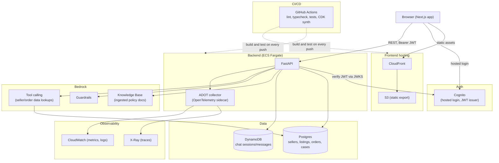

# Seller Support Copilot

An AI support assistant that helps e-commerce sellers get answers about marketplace policies, their orders, and their listings.

> **Work in progress.** 

## Architecture

The diagram below shows the target architecture.



Current state: the web app and FastAPI service run locally, with Postgres and DynamoDB Local in Docker. Sign-in uses a real Amazon Cognito user pool (`AuthStack`), and chat answers come from a real Amazon Bedrock Knowledge Base (`KnowledgeBaseStack`) plus Claude Haiku 4.5. Nothing in the Frontend hosting, Backend (ECS), Observability or Guardrails/Tool calling boxes is built yet; see the Roadmap.

## Tech stack

- **Frontend**: Next.js (App Router, static export), TypeScript, Tailwind CSS v4, TanStack Query, oidc-client-ts, Vitest + React Testing Library
- **Backend**: FastAPI (Python 3.12), SQLAlchemy 2.0 + Alembic, Pydantic v2, pytest
- **Data**: Postgres (relational: sellers, listings, orders, order_items, support_cases), DynamoDB (chat sessions/messages)
- **Auth**: Amazon Cognito (Authorization Code + PKCE, JWT verified in-process against JWKS)
- **AI**: Amazon Bedrock Knowledge Bases (S3 Vectors vector store, Titan Text Embeddings V2, hierarchical chunking); the API calls `Retrieve`, then `Converse` with Claude Haiku 4.5 (`us.` cross-region inference profile), with cited sources and a relevance floor that refuses without a model call. *Planned:* Guardrails, tool calling, structured outputs.
- **Observability**: JSON structured logs with a per-request `X-Request-ID`. *Planned:* OpenTelemetry, ADOT collector, CloudWatch, X-Ray.
- **Infra**: Docker Compose (local). AWS CDK with three stacks, deployed by hand after review and never by CI: `BudgetStack` (cost alerts), `KnowledgeBaseStack` (Bedrock KB, S3 docs bucket, S3 Vectors) and `AuthStack` (Cognito user pool, groups, hosted UI). Deploys use a scoped CloudFormation execution policy (`infra/bootstrap/`) instead of the default AdministratorAccess. *Planned:* ECS Fargate for the API, S3 + CloudFront for the web app.
- **CI/CD**: GitHub Actions (lint, typecheck, unit and integration tests, Docker build check, CDK synth on every push)

See [DECISIONS.md](DECISIONS.md) for why each of these was chosen and what was rejected.

## Roadmap

| Phase | Delivers | Status |
| --- | --- | --- |
| 0 | Monorepo scaffolding: repo layout, Docker Compose (Postgres, DynamoDB Local, API), GitHub Actions CI skeleton, CDK `BudgetStack` for cost alerts | **Done**: `docker-compose.yml`, `.github/workflows/ci.yml`, `infra/lib/budget-stack.ts` |
| 1 | Data layer: Postgres schema (sellers, listings, orders, order_items, support_cases) via SQLAlchemy + Alembic, DynamoDB chat store, deterministic seed script, refund-request service with row-level locking | **Done**: `models.py`, 2 Alembic migrations (reversibility checked in CI), `dynamo/chat_repository.py`, `scripts/seed.py`, `services/refunds.py` (`SELECT … FOR UPDATE`, concurrency test) |
| 2 | API: Cognito JWT verification and role-based access, REST endpoints under `/v1`, RFC 9457 `application/problem+json` errors, OpenAPI contract exported and checked in CI, 85% coverage gate | **Done**: `auth.py`, `routers/`, `errors.py`, OpenAPI drift check and 85% gate in CI |
| 3 | Frontend: Next.js static export, Cognito Authorization Code + PKCE login, generated TypeScript API client, seller and admin pages (orders, cases, chat, admin case queue), accessibility (Lighthouse 100/100 on the pages audited), Vitest test suite | **Done**: `apps/web`, `packages/api-client`; Vitest in CI |
| 4 | Bedrock: Knowledge Base retrieval over ingested policy docs, Guardrails, tool calling against seller/order data, structured outputs | **Partial.** Done: Knowledge Base on S3 Vectors (`KnowledgeBaseStack`), `Retrieve` + `Converse` answer path (`rag/`), citations, refusal floor, idempotent chat send, live local run verified 2026-10-29. Not done: Guardrails, tool calling, structured outputs |
| 5 | Eval harness: golden question set with expected facts, run on demand and gating CI on regression | **Partial.** Done: golden set (`evals/retrieval_golden.jsonl`), retrieval and answer evals, latest results `evals/results/retrieval-2026-10-29-04.json` and `evals/results/answers-2026-10-29-04.json`. Not done: CI gating (evals call live Bedrock, so they run by hand) |
| 6 | Observability: OpenTelemetry instrumentation in the API, ADOT sidecar forwarding traces to X-Ray and metrics/logs to CloudWatch | **Not started** (only JSON logs with request IDs exist) |
| 7 | End-to-end tests: Playwright driving the web app in a real browser | **Not started** |
| 8 | Deploy: FastAPI on ECS Fargate behind an ALB, Next.js static export on S3 + CloudFront | **Not started** (the app runs locally against AWS-managed Cognito and Bedrock) |
| 9 | Results: measure and report p95 latency, cost per query, eval pass rate, and final test coverage against the deployed system | **Not started** (no deployed system; the Results section below is local and eval-run numbers) |
| Stretch | SQS for async policy-document ingestion, a Lambda ingestion worker, rate limiting at the API Gateway/WAF layer. Redis was evaluated and cut (no measured hot path to justify it); see [DECISIONS.md](DECISIONS.md#cut-or-deferred). | **Not started.** CDK beyond the budget stack moved from Stretch to **Done**: `KnowledgeBaseStack` and `AuthStack` |

## Design decisions

Every non-obvious choice in this repo, what it does, why it was chosen over the alternatives, the tradeoff accepted, and when to revisit it, is recorded in [DECISIONS.md](DECISIONS.md). That includes FastAPI, Postgres, the DynamoDB key design, Cognito, keyset pagination, the admin case queue's ordering, oidc-client-ts, TanStack Query, and more.


## Repository layout

| Path | What |
| --- | --- |
| `apps/web` | Next.js frontend (static export; S3 + CloudFront hosting is planned, not built) |
| `services/api` | FastAPI backend |
| `services/ingest` | Placeholder. Ingestion is done by Bedrock Knowledge Bases: `make kb-upload` (S3 sync) and `make kb-ingest` (ingestion job) |
| `packages/api-client` | TypeScript API client generated from `services/api/openapi.json` |
| `infra` | AWS CDK app with three stacks: `BudgetStack`, `KnowledgeBaseStack`, `AuthStack`. CI builds, tests and synths them; deploying is a manual, reviewed step |
| `evals` | Golden question set, retrieval calibration and answer eval scripts; results in `evals/results/` (run by hand against live Bedrock) |
| `data` | Synthetic sample data, including the fictional marketplace's policy docs used by seeding and the Bedrock Knowledge Base |
| `DECISIONS.md` | What each component does, why it was chosen, and what was rejected |

## How to run locally

### Prerequisites

- Docker (with Compose v2)
- Python 3.12 and [uv](https://docs.astral.sh/uv/)
- Node 24 (see `.nvmrc`); pnpm via corepack (`corepack pnpm`, or `corepack enable`)
- Optional: [pre-commit](https://pre-commit.com/) (`pre-commit install`)

### Backend

```bash
make up             # Postgres, DynamoDB Local, API on :8000 (docker compose, rebuilds the API image)
make migrate         # apply Alembic migrations
make dynamodb-init   # create the local "chat" DynamoDB table
make seed            # deterministic synthetic sellers/listings/orders/cases (refuses if APP_ENV=prod)
make link-user EMAIL=<seed seller email> SUB=<cognito sub>   # link a seeded seller to a real Cognito user for local login
```

### Frontend

```bash
corepack pnpm install                          # from the repo root (pnpm workspace)
cp apps/web/.env.example apps/web/.env.local    # fill in Cognito values
corepack pnpm --filter @copilot/web run dev     # http://localhost:3000, needs the API running
```

### Run against real AWS (local app, AWS-managed Cognito and Bedrock)

The web app and API run on your machine. Sign-in goes through the deployed Cognito user pool (`AuthStack`) and answers come from the deployed Bedrock Knowledge Base (`KnowledgeBaseStack`). The API uses **your own AWS session** (`aws login`) for Bedrock, and nothing is deployed by these steps. Prerequisites:
- both stacks are deployed
- a Cognito user exists (`make auth-create-user EMAIL=... GROUP=seller`)
- Docker is running

```bash
aws login                      # fresh session; the API on the host uses it for Bedrock
make live-env                  # writes services/api/.env + apps/web/.env.local from the stack outputs (gitignored)
make dev-live                  # Postgres + DynamoDB Local in Docker, migrate, table init, seed once, API on :8000
```

In a second terminal:

```bash
make link-user EMAIL=fwilson@johnson.com SUB=<your Cognito sub>   # once: maps your login to a seed seller
cd apps/web && corepack pnpm dev                                    # http://localhost:3000
```

`make dev-live` starts only Postgres and DynamoDB Local; it doesn't build the API image. DynamoDB Local runs with `-sharedDb`, so the table that `make dynamodb-init` creates with dummy keys is visible to the API's real session keys. The CSP isn't applied under `next dev`; it only applies to the production build. Limits of this setup are listed in DECISIONS.md, under Known open issues.

### Local end-to-end run (verified 2026-10-29)

Run with the steps above (local web app and API, deployed Cognito user pool and Bedrock Knowledge Base). The reviewer checked the screenshots:

- **Sign-in:** the Cognito hosted-UI sign-in as the seller test user worked, and the nav showed the signed-in user.
- **Answerable question:** "How many days does a buyer have to request a refund?" was answered "A buyer can request a refund within **30 days** of the order's delivery date [1]..." with one source. That matches `returns-and-refunds.md`.
- **Off-topic question:** "What is the capital of France?" got the exact refusal message from `rag/prompt.py`. Retrieval scored below `rag_min_score` (0.55), so the model was never called.

Honest limits of this run:
- The app isn't deployed to AWS. Only Cognito and the Bedrock Knowledge Base are AWS-managed.
- The local API uses the developer's own AWS credentials, so a least-privilege runtime role isn't exercised.
- No Secrets Manager: this setup has no application secret.

Known UI issues found during the run (DECISIONS.md, Known open issues):
- "New session" is disabled, with no hint, until a title is typed.
- Answer markdown renders as literal asterisks.
- Citation snippets show the parent chunk's intro, not the sentence that supports the answer.

### Checks

```bash
make lint               # ruff (api) + eslint (web)
make typecheck           # mypy (api) + tsc (api-client, web) + CDK build (infra)
make test                # unit tests: pytest (api, no external deps) + CDK tests
make test-integration    # integration tests: pytest -m integration (needs `make up`)
make coverage            # unit + integration coverage for services/api; fails under 85%
make openapi-check       # fails if openapi.json is stale
make api-client-check    # fails if the generated TS client is stale
corepack pnpm --filter @copilot/web run test    # Vitest
```

Other targets: `make down` (stop containers, keeps the Postgres volume), `make openapi` / `make api-client` (regenerate without the drift check).

## Cost and teardown

- Local development costs nothing. `make down` stops containers; `docker compose down -v` also deletes the Postgres volume.
- Nothing is deployed to AWS automatically. CI only runs `cdk synth`.
- Deploy the budget first so spend is tracked from day one (default 25 USD/month, email alerts at 50%, 80%, 100% actual and 100% forecasted):
  `cd infra && npx cdk deploy BudgetStack -c budgetEmail=you@example.com`
- Teardown: `cd infra && npx cdk destroy --all -c budgetEmail=you@example.com`. Bedrock, databases and Fargate are billable; destroy them when not in use.

## Results

Measured locally on 2026-11-07 on `main` at `f80eb95`, with the same commands CI runs.

| Metric | Value |
| --- | --- |
| Backend tests | 178 passing: 75 unit + 103 integration (pytest; integration against Postgres 16 and DynamoDB Local) |
| Backend coverage | 90% combined unit + integration (CI gate: 85%) |
| Frontend tests | 61 passing in 12 files (Vitest) |
| Infra tests | 51 passing in 4 suites (Jest: `AuthStack`, `KnowledgeBaseStack`, `BudgetStack`, CloudFormation execution policy) |
| Accessibility | Lighthouse 100/100 on the pages audited in phase 3 (not re-run since) |
| CI | 4 jobs (api, web, infra, api-image), 64–78 seconds for the last three runs on `main` |
| Seed data | about 20 sellers, 60+ listings, 500 orders |

### RAG chat (retrieval and answers)

Measured on 2026-10-29 with live Amazon Bedrock calls: Knowledge Base retrieval with hierarchical chunking, answers from Claude Haiku 4.5 via the `us.` inference profile, `rag_min_score` 0.55.

| Metric | Value |
| --- | --- |
| Retrieval hit@1 / hit@5, source-level | 95% / 100% (20 in-scope questions) |
| Retrieval hit@1 / hit@5, fact-level (a retrieved chunk contains the expected fact) | 95% / 100% |
| Answers, in-scope (expected fact stated and expected source cited) | 20/20 |
| Answers, out-of-scope (refusal with zero citations) | 9/10. The one miss was a safe refusal worded outside the scorer's pattern. |
| Cost per question (estimate) | about $0.0022 averaged over all 30 questions, or about $0.0026 per model call (4 of the 30 were refused without one): Converse tokens at Bedrock on-demand Haiku 4.5 Geo pricing, excluding retrieval |

Caveats: 30 questions (20 in-scope, 10 out-of-scope), written by the same author as the policy documents, so expect these numbers to be optimistic compared with real seller questions. Scoring is deterministic (key-term and citation checks, no LLM judge). Methodology, scoring rules, known limitations and the raw results files are in [evals/README.md](evals/README.md).
